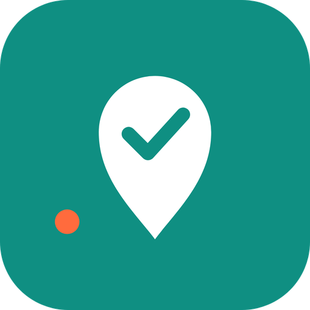
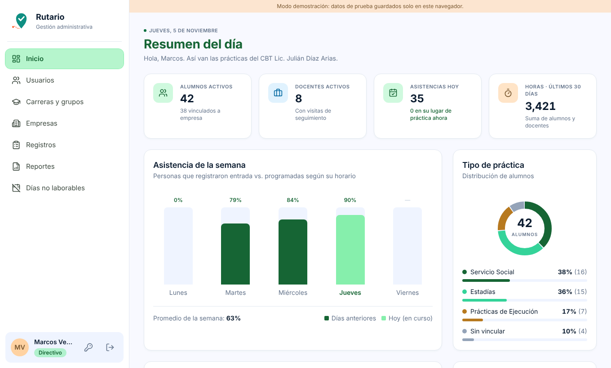
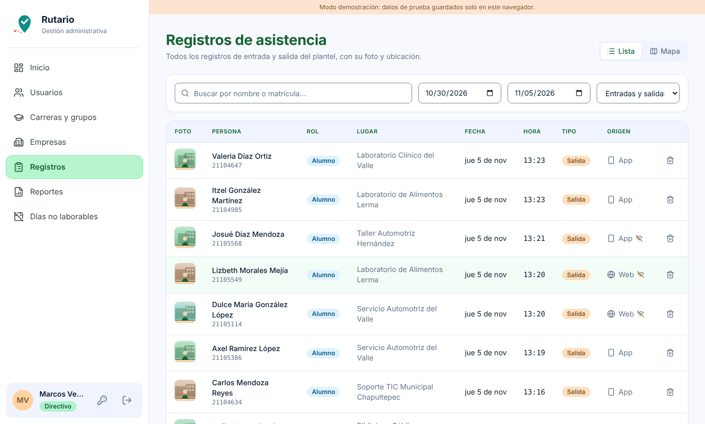
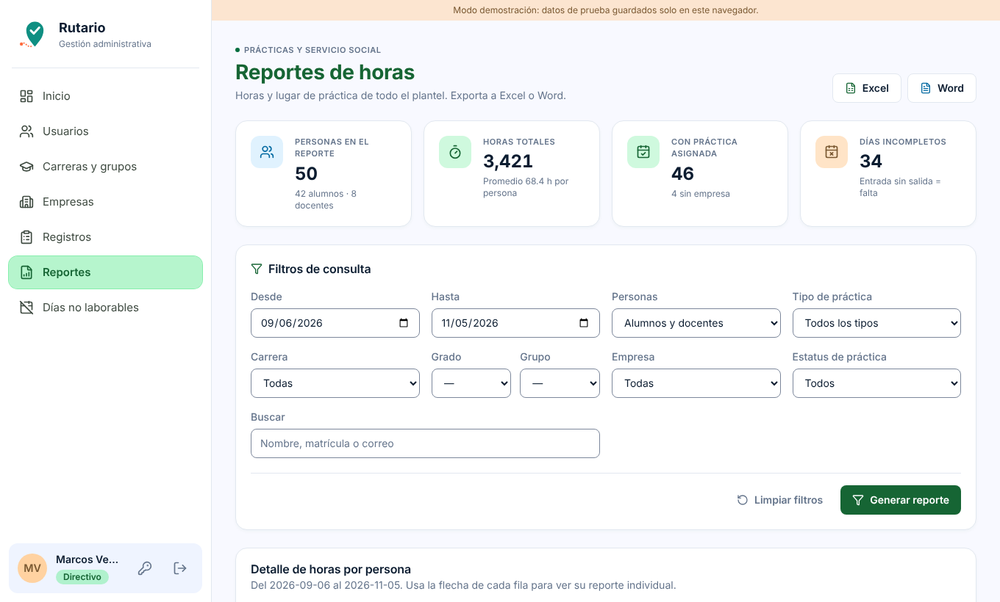
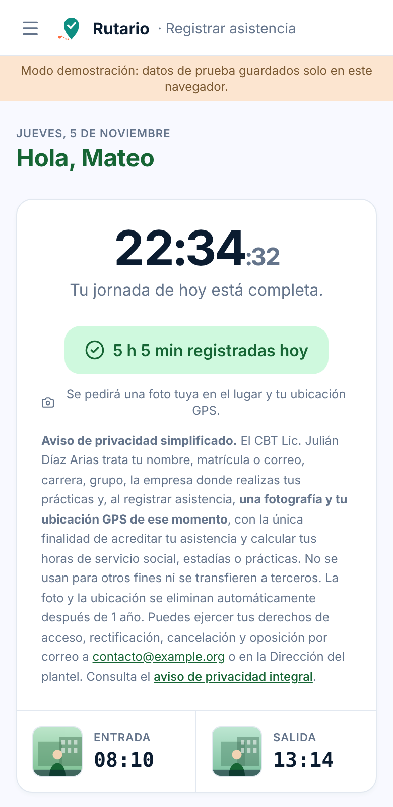
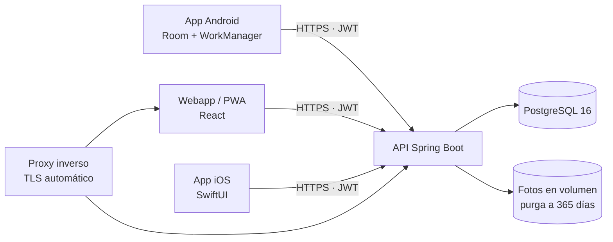

<p align="center">
  
</p>

<h1 align="center">Rutario</h1>
<p align="center"><em>De la ruta al reporte, en un toque.</em></p>

<p align="center">
  
  
  
  
  
  
</p>

Sistema de control de **prácticas escolares con evidencia verificable**: alumnos y docentes registran su
entrada y salida con **foto y GPS** desde el celular; vinculadores, orientadores y directivos ven en un mapa
dónde y cuándo se registró cada quien, administran empresas y vinculaciones y exportan reportes de horas a
Excel y Word.

Nació como mi proyecto de **servicio social** (jun–nov 2026) en un bachillerato tecnológico del Estado de México
y **está en producción**, diseñado para unos 400 alumnos en prácticas.

### 👉 [Probar la demo en vivo](https://enriqueleondev.github.io/rutario/)

La demo es la webapp completa con datos ficticios que viven solo en tu navegador. Entra con cualquiera de
los botones "Entrar como" y recorre los seis roles.

## Capturas

| Resumen del directivo | Registros con foto y ubicación |
|---|---|
|  |  |

| Reportes | Portal del alumno (móvil) |
|---|---|
|  |  |

## Componentes

| Componente | Stack | Código |
|---|---|---|
| [`frontend/`](frontend) | Webapp PWA: React · TypeScript · Vite · Tailwind | Público (modo demo) |
| [`backend/`](backend) | API REST: Java · Spring Boot · PostgreSQL · Flyway | Privado |
| [`android/`](android) | App nativa offline-first: Kotlin · Compose · Room · CameraX · WorkManager | Privado |
| [`ios/`](ios) | App nativa: Swift · SwiftUI | Privado |

## Arquitectura



Decisiones que vale la pena revisar:

- **Offline-first en Android.** Los registros se guardan en Room y se sincronizan con WorkManager cuando
  vuelve la red; la sesión offline usa refresh token de 30 días.
- **Evidencia difícil de falsear.** La app Android se bloquea con *opciones de desarrollador* activas y rechaza
  ubicación simulada; la web captura la cámara dentro de la página y usa GPS con respaldo.
- **Sesión revocable.** `token_version` en el usuario invalida los JWT al cerrar sesión o restablecer contraseña.
- **Privacidad por diseño.** Aviso de privacidad versionado, cambio obligatorio de contraseña en el primer
  acceso, límite de intentos, purga de fotos y coordenadas a los 365 días, respaldos cifrados y cabeceras de seguridad.
- **Migraciones versionadas** con Flyway.
- **Seis roles:** Root, Directivo, Vinculador, Orientador, Docente y Alumno.
- **Despliegue:** Docker Compose y HTTPS automático con Caddy en un VPS.

## Correr la webapp en local (modo demo)

```bash
cd frontend
cp .env.example .env      # VITE_USE_MOCK=true
npm ci
npm run dev
```

## ¿Necesitas algo parecido?

Construyo sistemas a medida con este mismo enfoque (API, webapp y apps móviles nativas).
Escríbeme a leonenriquer201@gmail.com.

## Autor

**Enrique Rentería León** (enriqueleondev) — Ingeniería en Software, UAEM.
[GitHub](https://github.com/enriqueleondev) · [LinkedIn](https://www.linkedin.com/in/enrique-renteria-le%C3%B3n-71ba393b5)

## Licencia

Todos los derechos reservados. El código visible aquí es para evaluación. Ver [LICENSE](LICENSE).
